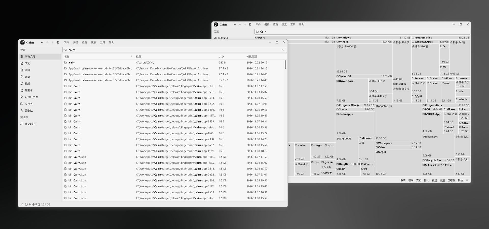

<div align="center">
  <h1 align="center" style="border-bottom: none">
    <picture>
      <source media="(prefers-color-scheme: dark)" srcset="docs/cairn-header-dark.png">
      <source media="(prefers-color-scheme: light)" srcset="docs/cairn-header-light.png">
      
    </picture>
  </h1>
  <p><strong>面向 Windows 10/11 的高性能本地文件搜索与磁盘空间可视化工作台</strong></p>
  <p>
    <a href="LICENSE"></a>
    
    
    
    
  </p>
</div>

<p align="center">
  
</p>

## 项目概览

Cairn 将本地文件检索与磁盘空间占用分析收敛于同一桌面工作台。底层直接解析 NTFS `$MFT` 主文件表并订阅 USN 变更日志，在低内存占用下完成冷启动加载、目录体量聚合与实时增量同步。

桌面端基于 GPUI Kit 构建硬件加速界面，通过异步 Windows 命名管道与后台索引服务 `CairnService` 通信解耦；可选全文检索由独立子进程 `CairnWorker.exe` 承担文档提取与 Tantivy 索引写入。

## 核心能力

- **NTFS 实时索引**：直接读取 `$MFT` 记录与非常驻 Runlist，结合 USN Journal 增量回放、缓存校验与离线卷重连恢复。
- **结构化查询引擎**：支持布尔逻辑、通配符、正则表达式、大小/时间范围、类型过滤与多卷并行施瓦茨变换排序。
- **进程隔离全文检索**：内置 CJK 双字与拉丁混合分词器，支持纯文本、代码、PDF 与 DOCX 内容提取。
- **Treemap 磁盘空间分析**：基于 Squarified 算法构建交互式矩形树图，支持连续缩放平移、下钻导航与类别筛选。
- **原生 Shell 与回收站集成**：提供虚拟滚动结果表、中英双语切换、Windows 回收站枚举还原与系统原生属性对话框联动。
- **安全与权限边界**：命名管道拒绝远程客户端，按调用方访问令牌实施鉴权，配置文件与索引存储强制绑定系统级安全描述符。

## 技术栈

| 层级 | 技术 | 职责 |
| --- | --- | --- |
| 桌面界面 | Rust、GPUI Kit、Fluent | GPU 渲染界面、固定行高虚拟滚动、Treemap 画布与中英双语本地化 |
| 进程通信 | Tokio Named Pipe、Postcard、CRC32 | 定长帧编解码、超时与背压控制、会话分页缓存与增量状态同步 |
| 文件系统 | Win32 Storage / IO API、`cairn-ntfs` | `$MFT` 扇区流式解析、USN 变更日志轮询与目录大小聚合 |
| 全文索引 | Tantivy 0.27、lopdf、quick-xml、zip | CJK 双字分词、多格式文本提取、倒排索引构建与匹配摘要生成 |
| 系统服务 | `windows-service`、Win32 Security / Shell COM | SCM 服务托管、客户端令牌鉴权、SDDL 权限加固与回收站操作 |
| 分发打包 | `xtask`、WiX Toolset v5 | MSI 安装包、GPUI 安装程序（`CairnSetup.exe`）、校验清单与构建门禁 |

## 快速开始

### 环境要求

- Windows 10 / 11（x64）与 PowerShell 7+
- Rust stable（见 `rust-toolchain.toml`；`x86_64-pc-windows-msvc`）
- WiX Toolset v5（构建安装包）

### 本地开发与运行

```powershell
# 控制台模式启动后台索引服务
cargo run -p cairn-service -- --console

# 启动桌面客户端
cargo run --profile dev-ui -p cairn-app

# 命令行检索与状态查询
cargo run -p cairn-cli -- --status
cargo run -p cairn-cli -- "ext:rs" --max 50 --sort size --asc=false
```

### 构建与打包发布

```powershell
cargo build --workspace --release
cargo run -p xtask -- package
```

打包产物输出至 `dist/`（含 `CairnSetup.exe`、`cairn.msi` 与 `SHA256SUMS.txt`）。完整发布规程见[打包与发布](docs/engineering/release.md)。

## 验证

```powershell
cargo fmt --all -- --check
cargo clippy --workspace --all-targets -- -D warnings
$env:RUSTDOCFLAGS="-D warnings"; cargo doc --workspace --no-deps
cargo test --workspace
cargo deny check
cargo run -p xtask -- check-i18n
cargo run -p xtask -- check-docs
cargo run -p xtask -- check-size
```

工作区测试含 4 个 `#[ignore]` 用例，前置条件与运行命令见[测试与验证](docs/engineering/testing.md)；内容回填端到端用例由 CI 的 `Test / Service` 作业执行。

## 仓库结构

```text
crates/
  cairn-core/      查询语法 AST、过滤评估、自然排序与 Treemap 布局算法
  cairn-protocol/  Named Pipe 帧协议、Postcard 载荷与状态数据结构
  cairn-ntfs/      NTFS 引导扇区、$MFT 记录、Runlist 与 USN 日志解析
  cairn-content/   Tantivy 全文索引、CJK 分词器与文档内容提取器
  cairn-client/    异步 Named Pipe 客户端、版本握手与错误分类
  cairn-service/   CairnService 系统服务、多卷同步引擎、会话缓存与调用方鉴权
  cairn-worker/    全文索引提取与合并隔离子进程
  cairn-app/       GPUI Kit 桌面客户端、虚拟表格、Treemap 与 Shell 集成
  cairn-cli/       命令行检索与 CSV / JSON 导出工具
  cairn-ui/        共享品牌、主题令牌与组件主题适配
  cairn-setup/     GPUI 安装/卸载前端与 MSI 载荷
  cairn-setup-bin/ CairnSetup.exe 入口
xtask/             国际化对齐校验、基准测试与 WiX 安装包构建自动化
assets/icons/      应用 SVG 母版与固定阶梯光栅图标资产
docs/              产品规格、工程架构与外部调研文档
```

## 文档

| 文档 | 范围 |
| --- | --- |
| [产品规格](docs/SPEC.md) | 产品范围、需求 ID、性能预算与验收标准 |
| [界面与交互](docs/product/ui.md) | 窗口布局、设计令牌、键盘导航与无障碍规范 |
| [查询语法](docs/product/search-syntax.md) | 布尔表达式、宏、属性过滤与全文检索语法 |
| [Treemap 视图](docs/product/treemap.md) | 磁盘空间聚合、Squarified 布局与缩放平移交互 |
| [品牌资产](docs/product/brand.md) | 图标母版、光栅尺寸阶梯与使用位置 |
| [系统架构](docs/engineering/architecture.md) | Crate 边界、进程拓扑与模块职责 |
| [索引与同步](docs/engineering/indexing.md) | `$MFT` 扫描、USN 对齐、缓存持久化与内容索引流水线 |
| [前端与 GPUI](docs/engineering/frontend.md) | 布局、焦点、IME 与窗口行为 |
| [IPC 与安全](docs/engineering/ipc-security.md) | 协议帧限制、管道 ACL、调用方令牌鉴权与配置保护 |
| [性能](docs/engineering/performance.md) | 性能目标、内存与 Treemap 预算 |
| [质量](docs/engineering/quality.md) | 测试分层与 CI 质量门禁 |
| [打包与发布](docs/engineering/release.md) | GPUI Setup、WiX MSI、校验清单与发布门禁 |
| [研究与竞品](docs/research/README.md) | 外部产品调研与证据索引 |
| [贡献指南](CONTRIBUTING.md) | 开发环境、工程规范与 PR 流程 |

## 许可证

Cairn 采用 [Apache-2.0 License](LICENSE)。
