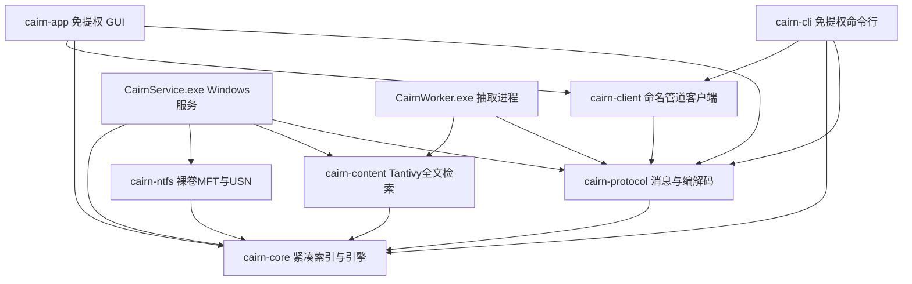
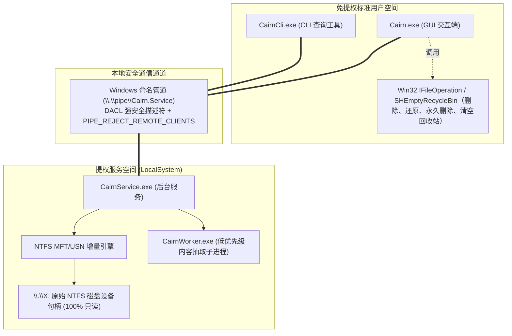

# 系统架构、技术选型与安全

> 实现细节与当前验证见 [ipc-security.md](ipc-security.md)、[indexing.md](indexing.md)、[frontend.md](frontend.md)。

## 1. 系统架构与数据流模型

### 1.1 Cargo Workspace 单向分层
工作区依赖严格遵循从外向内单向指引，内核底层严禁依赖外层或 Windows API：

`cairn-service` 的 `cairn-client` 仅为 dev-dependency，用于真实管道集成测试，不构成运行时依赖。`xtask` 不在运行时拓扑中，负责 i18n 校验、打包、基准、VHD 与安全集成测试。

### 1.2 多进程协同与权限隔离模型

- **服务只读权限收敛**：`CairnService.exe` 以 `LocalSystem` 启动，对裸盘只读；写权限仅限受保护的服务数据目录（索引缓存、内容索引、配置与日志）。其管道通信层完全不提供任何写磁盘、删文件或改文件名的接口。
- **免提权文件写操作**：用户在 GUI 执行的删除到回收站、从回收站还原、永久删除与清空回收站，由 `Cairn.exe` 直接向系统 Shell COM 发起 `IFileOperation` / `SHEmptyRecycleBin`，自然承接操作系统的回收站安全策略、撤销列表与原生进度/错误 UI。日常删除与永久删除先经过项目统一确认框；清空回收站保留原生警告；`F2` 重命名尚未实现。

### 1.3 紧凑内存索引模型（≤ 125 Bytes/条）
- **定长文件记录（`FileRecord`，紧凑对齐，约 48 字节；字段净荷约 40 字节）**：
  包含 64 位文件引用号（FRN）、父目录下标 `parent_idx`、名称池偏移与长度、扩展名相对偏移、卷标识、DOS 属性与目录标记位、64 位大小、修改与创建时间戳。文件的大小是自身逻辑大小；目录的大小是索引内后代文件逻辑大小之和，随 USN 变更沿父链增量维护，因此表格显示、排序与 `size:` 过滤共用同一值。内存中绝不直接存储完整路径字符串。
- **连续名称池（`NamePool` Arena）**：
  所有 UTF-8 文件名紧凑连续写入单一字节向量 `Vec<u8>`，并同步维护 Unicode 大小写折叠副本 `folded_arena`，彻底避免数百万次碎片化堆内存分配。
- **路径按需拼接与缓存**：
  仅在匹配带路径查询或客户端拉取分页数据时，沿 `parent_idx` 回溯祖先链即时拼接路径，辅以目录级路径缓存（`DirectoryPathCache`）实现 $O(1)$ 均摊开销。
- **预排序加速索引**：
  为名称、大小、时间等排序列分别维护一个仅占 4 字节的下标排列向量 `Vec<u32>`，大幅削减交互排序的瞬时 CPU 消耗。
- **排除路径的预计算掩码**：
  空查询（全文件视图）把默认的段规则（如 `$Recycle.Bin`、`System Volume Information`）沿 `parent_idx` 链归约为每卷 `Vec<bool>` 掩码，逐条记录零分配判定；含 glob、绝对路径或多段相对路径的规则保留完整路径参考检查。全文件查询通过每卷掩码避免为每条记录重建路径，精确 `total_matches` 与首屏一起及时返回。

### 1.4 USN 增量同步与故障自愈状态机
- 每卷在持久化缓存头中记录 `(volume_serial_number, usn_journal_id, next_usn)`。
- 启动时通过 `FSCTL_QUERY_USN_JOURNAL` 严格核验：若日志 ID 不匹配或保存的 USN 发生回绕失效，仅触发该故障单卷标记为 `Rebuilding` 并触发后台局部重建，其余健康卷立刻转入 `Synced` 响应搜索。
- 采用自适应阻塞轮询读取 USN 记录：追赶阶段 50ms，全部同步后恢复 500ms；创建、删除、重命名事件直接增量入库，数据修改事件记入待复查集合，经 1~2 秒去抖批量刷新元数据。
- 卷未启用 USN 时，优雅降级为 `SnapshotMode` 快照模式并支持低频定时重新扫描。

### 1.5 NTFS $MFT 流式分块解析引擎
- 使用 `CreateFileW` 打开裸卷设备 `\\.\C:`（不带尾部反斜杠），共享模式设为 `FILE_SHARE_READ | FILE_SHARE_WRITE | FILE_SHARE_DELETE`。
- 解析引导扇区（Boot Sector）获取每扇区字节数、每簇扇区数与 MFT 起始簇（LCN）。
- 解析 0 号记录非驻留 `$DATA` 属性的 Runlist 映射簇物理偏移；`$BITMAP` 预跳过尚未实现。
- 采用滑动窗口顺序流式分块读取，结合 Rayon 并行线程池解压 Fixup 校验序列与多属性记录，跳过系统保留元文件与未分配簇。

### 1.6 命名管道 IPC 协议与帧封装
- 管道地址：服务 `\.\pipe\Cairn.Service`；标准用户降级索引器 `\.\pipe\Cairn.User`。
- 协议帧携带显式协议版本；连接必须先完成 `Hello` 握手，版本不匹配时拒绝请求。`QueryResult` 携带可见匹配文件的自身字节合计，表格底栏据此显示 `N 个项目 X`。
- 帧格式：`[u32: 负载长度][u16: 协议版本][postcard 序列化二进制内容]`。
- 响应封套：所有服务端响应必须包裹 `Envelope<T>` 并携带各卷状态列表（`VolumeStatusSummary`）。普通响应使用最近一次完整摘要缓存，避免查询持锁期间新连接的握手等待数秒；查询结果使用查询释放索引后的新鲜摘要，使客户端的加载/过渡决策基于本次结果之后的卷状态。
- 请求包含：`Hello`、`Query`、`Cancel`、`GetRows`、`GetStatus`、`Rescan`、`GetConfig`、`SetConfig`、`ReloadConfig`、`GetContentIndexStatus`、`CancelContentIndex`、`ClearContentIndex`、`GetTree`。
- 卷状态是**请求/响应采样**，不是广播订阅：`GetStatus` 读一次当前状态，状态本身在响应封套的卷列表里，负载只是确认。`Cancel` 用自己的确认应答，不复用状态应答。
- `CancelContentIndex` 是协议已具备的能力，**当前产品未接入**：界面的“关闭内容搜索”走 `SetConfig`，因此这条请求在客户端没有调用点。

### 1.7 Windows 中文输入法（IME）四大缺陷根治机制
1. **防重复上屏与丢字**：在 `EntityInputHandler` 中精确区分 `WM_IME_COMPOSITION` 组合态与最终 `WM_CHAR` 提交，上屏后即时清空 `marked_range` 并拦截同一按键周期的冗余字符。
2. **候选窗跟随光标**：通过 `bounds_for_range` 结合文本排印行坐标与当前屏幕 DPI 缩放比，精确计算输入光标的真实像素位置。
3. **安全避让输入行**：计算候选窗坐标时向下注入 4px 垂直缓冲边距，使 Windows 系统输入法候选窗始终置于输入框下外侧，绝不遮挡输入内容。
4. **UTF-16 与 UTF-8 选区无损映射**：维护双向字符偏移映射表，杜绝因直接切片 UTF-8 字符串导致的下标错位或崩溃。

### 1.8 物理数据存储位置与权限清单

| 内容项目 | 物理存储路径 | 权限控制标准 |
|:---|:---|:---|
| 文件名索引缓存 | `%ProgramData%\Cairn\index\vol_<drive>.idx` | 仅 SYSTEM 与 Administrators 可读写 |
| 全文内容索引 | `%ProgramData%\Cairn\content\` | 仅 SYSTEM 与 Administrators 可读写 |
| 服务端配置文件 | `%ProgramData%\Cairn\service.toml` | 仅 SYSTEM 与 Administrators 可写 |
| 服务端运行日志 | `%ProgramData%\Cairn\logs\` | 仅 SYSTEM 与 Administrators 可读写 |
| 客户端偏好设置 | `%APPDATA%\Cairn\settings.toml` | 当前登录标准用户可读写 |
| 客户端运行日志 | `%LOCALAPPDATA%\Cairn\logs\` | 当前登录标准用户可读写 |

---

## 2. 技术选型与供应链治理

| 领域 | 选型组件 | 选型考量与使用约束 |
|:---|:---|:---|
| **开发语言** | Rust Stable（锁定于 `rust-toolchain.toml`） | 内存安全、零成本抽象、高性能并发 |
| **桌面 GUI 框架** | `gpui-kit`（基于 GPUI） | GPU 加速渲染、现代声明式 UI、原生接入 Windows 无障碍 AccessKit |
| **Windows 底层 API** | `windows-rs` | 官方 Win32 / COM 强类型系统调用与句柄封装 |
| **Windows 服务宿主** | `windows-service` | 官方标准 Windows 服务控制管理器（SCM）集成 |
| **全文检索引擎** | `tantivy` | 高性能 Rust 原生搜索引擎，轻量无 JVM 依赖 |
| **并发并行计算** | `rayon` | 细粒度数据并行与轻量任务窃取线程池 |
| **子串高速扫描** | `memchr`（`memmem`） | 极致 SIMD 向量化加速子串匹配 |
| **序列化与配置** | `postcard`（IPC） / `toml`（配置） | 高密度零拷贝二进制通信与易读配置文件格式 |
| **文本编码自动识别** | `chardetng` + `encoding_rs` | 准确识别 GBK、UTF-16、BOM 等中文编码 |
| **系统托盘** | `tray-icon` | Windows 系统原生托盘菜单；全局热键尚未接入 |
| **界面国际化 (i18n)** | `fluent-bundle` | 现代化多语言文案管理与参数化插值 |
| **日志与链路追踪** | `tracing` + `tracing-subscriber` | 结构化异步日志输出与性能诊断 |
| **测试框架** | `cargo test` + `proptest`（可选 `cargo-nextest`） | CI 使用 `cargo test`；属性随机测试由 `proptest` 承担 |
| **发布打包工程** | GPUI Setup 前端 + WiX v5 MSI（事务引擎） | 产出合规的单文件安装包 `CairnSetup.exe`；共享产品 token 与卸载入口，MSI 不暴露原生 UI |

---

## 3. 安全边界

安全实现、DACL、索引目录权限、第三方提取隔离与零遥测约束见 [ipc-security.md](ipc-security.md)。
